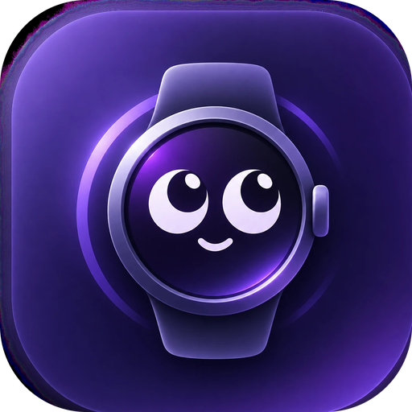

<p align="center"></p>

<h1 align="center">WristEyes</h1>

Talk to your Wear OS watch from your computer — or let an AI assistant do it.

WristEyes is a tiny app for Wear OS that serves a JSON API on your Wi-Fi, plus an
[MCP](https://modelcontextprotocol.io) server so Claude, Cursor or any MCP client can
read the watch's sensors and reach you on the wrist.

> "What's my heart rate?" → the assistant asks the watch → `68 bpm`

## What it can do

| Command | What happens |
|---|---|
| `watch_info` | model, Android version, battery, charging, screen on/off |
| `read_sensor` | heart rate, steps, pressure + altitude, compass, light, on-wrist, accelerometer, gyroscope, magnetometer |
| `vibrate` | buzz the watch (length and count) |
| `notify` | post a notification |
| `show_text` | big text on the whole screen |
| `say` | speak text through the watch speaker |

Tested on a **TicWatch Pro 5** (Wear OS 4 / Android 13). Should work on any Wear OS 3+ watch.

## Setup

### 1. Watch app

You need ADB over Wi-Fi on the watch (Settings → Developer options → Wireless debugging).

```bash
./gradlew :app:assembleDebug
adb install app/build/outputs/apk/debug/app-debug.apk
```

Open **WristEyes** on the watch and allow the permissions. The screen shows the
address (`192.168.x.x:8765`) and a token.

Optional, so `show_text` can open full screen even when the app is in the background:

```bash
adb shell appops set com.wristeyes SYSTEM_ALERT_WINDOW allow
```

### 2. MCP server

```bash
cd mcp
python3 -m venv .venv
.venv/bin/pip install -r requirements.txt
```

Add it to Claude Code:

```bash
claude mcp add wristeyes --scope user \
  -e WRISTEYES_URL=http://192.168.x.x:8765 \
  -e WRISTEYES_TOKEN=<token from the watch> \
  -- "$PWD/.venv/bin/python" "$PWD/server.py"
```

Claude Desktop, Cursor and others take the same command and env in their MCP config.

## HTTP API

Every call except `GET /` needs `Authorization: Bearer <token>`.

```bash
curl -H "Authorization: Bearer $TOKEN" http://192.168.x.x:8765/info
curl -H "Authorization: Bearer $TOKEN" "http://192.168.x.x:8765/sensor?type=heart_rate"
curl -H "Authorization: Bearer $TOKEN" -d '{"ms":300,"times":2}' http://192.168.x.x:8765/vibrate
curl -H "Authorization: Bearer $TOKEN" -d '{"text":"Hi!"}' http://192.168.x.x:8765/show
```

| Method | Path | Body / query |
|---|---|---|
| GET | `/info` | |
| GET | `/sensors` | |
| GET | `/sensor` | `?type=heart_rate&timeout=30` |
| POST | `/vibrate` | `{"ms":400,"times":1}` |
| POST | `/notify` | `{"title":"...","text":"..."}` |
| POST | `/show` | `{"text":"...","seconds":8}` |
| POST | `/say` | `{"text":"...","lang":"en"}` |

The watch also announces itself on the network as `_wristeyes._tcp`.

## Notes

- The API is meant for your home network. Anyone with the token can buzz your watch, so keep it private.
- The app holds Wi-Fi and a wake lock while running, which costs some battery. Stop it from the app when you don't need it.
- Heart rate needs the watch on your wrist and takes 5–30 seconds.

## Roadmap

- Animated eyes on the watch face that react to commands
- Voice assistant on the watch
- Music control, files, reminders

## License

MIT
